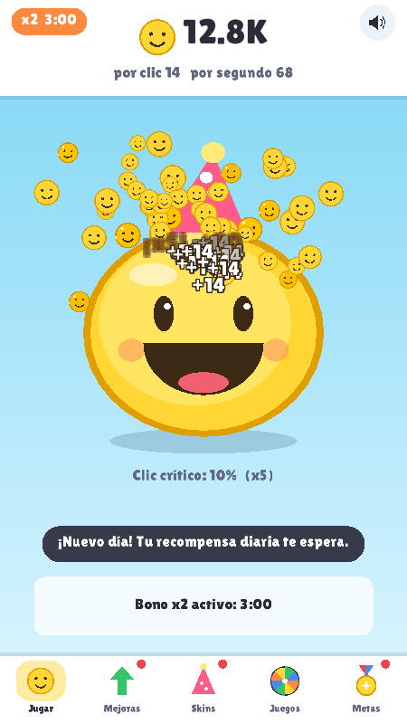

# Verity

Un juego de clics con una bolita amarilla sonriente, hecho en **C++** con la biblioteca **raylib**.
Funciona en **Android** y en **Windows** con el mismo código.

Tocas la bolita y suelta sonrisas. Con las sonrisas compras mejoras, skins y entradas a minijuegos.
Incluye anuncios de Google AdMob en Android.



## Qué trae

- **Bolita clicable** que suelta sonrisas, con clics críticos (x5) y animaciones.
- **12 mejoras**: más sonrisas por clic, probabilidad de crítico y producción automática por segundo.
- **5 skins** que se compran y se pueden cambiar cuando quieras: Clásica, Gafas de sol, Gorro de fiesta, Ojos de corazón y Corona.
- **3 minijuegos** que se pagan con sonrisas: *Atrapa sonrisas* (15 segundos), *Memoria de sonrisas* (repite la secuencia de colores, hasta 15 rondas) y *Ruleta de la suerte*.
- **Pestaña Metas**:
  - **Recompensa diaria** con racha de 7 días (cada día premia más; si faltas un día, la racha vuelve al día 1).
  - **3 misiones nuevas cada día** (tocar, ganar sonrisas, comprar mejoras, jugar minijuegos...).
  - **19 medallas**; cada una da **+2 % de sonrisas** para siempre.
- **Anuncios**: banner abajo y anuncios con recompensa (bono x2 por 3 minutos; también duplican el premio de los minijuegos, lo ganado mientras el juego estaba cerrado y la recompensa diaria).
- **Guardado automático** y ganancias mientras el juego está cerrado (hasta 2 horas, al 50 %).
- Sonidos generados por código, sin archivos de audio ni imágenes.

## Lo que está probado y lo que no

| Parte | Estado |
| --- | --- |
| Reglas del juego (economía, mejoras, skins, minijuegos, ruleta, guardado) | Probado con 12.071 comprobaciones automáticas (`tests/`) |
| Pantallas en teléfono vertical, teléfono alargado y ventana ancha de PC | Revisadas con capturas |
| Compilación para Windows 64 bits | Compila y enlaza. **No se ha ejecutado en una computadora con Windows.** |
| Proyecto de Android y puente con AdMob | **Escrito pero no compilado ni probado en un teléfono.** Necesita el SDK de Android, que no estaba disponible donde se creó. Es probable que pida algún ajuste la primera vez. |
| Anuncios reales | No probados. Usan los identificadores de **prueba** de Google. Mira la sección de AdMob. |

## Importante: "Google Ads" y AdMob

**Google Ads** es el servicio para *comprar* publicidad. Para *ganar dinero mostrando* anuncios en una app
se usa **Google AdMob**, que es lo que usa este proyecto.

**AdMob solo funciona en Android y iPhone, no en Windows.** Por eso la versión de Windows no muestra
anuncios reales: en su lugar hay una pantalla de "Anuncio de prueba" de 3 segundos para poder probar el
juego completo. En Windows se podría ganar dinero vendiendo el juego (por ejemplo en itch.io o Microsoft Store)
o conectando otra red de anuncios para escritorio.

## Jugar en Windows

Hay cuatro versiones del `.exe`, para que funcione hasta en computadoras viejas:

| Archivo | Para quién |
| --- | --- |
| `1-...64bits-OpenGL2.exe` | Casi cualquier PC de 64 bits (prueba esta primero) |
| `2-...64bits-OpenGL1-lento.exe` | PC de 64 bits muy vieja o con gráficos limitados |
| `3-...32bits-OpenGL2.exe` | Windows de 32 bits |
| `4-...32bits-OpenGL1-lento.exe` | Windows de 32 bits muy viejo |

Para compilarlas tú mismo, agrega `-DOPENGL_VERSION=2.1` (o `1.1`) al comando `cmake` de abajo. Sin esa opción se
usa OpenGL 3.3, que no tienen las computadoras de hace más de 10 años.

Descomprime el zip y haz doble clic en el `.exe`. Es un solo archivo. La partida se guarda en
`%APPDATA%\Verity\verity.sav`.

## Compilar para Windows

Necesitas [CMake](https://cmake.org/download/) y un compilador de C++. La primera vez descarga raylib
automáticamente (hace falta internet y [Git](https://git-scm.com/)).

**Opción A: Visual Studio** (Community, gratis, con la carga "Desarrollo para el escritorio con C++"):

```
cmake -S . -B build -A x64
cmake --build build --config Release
build\Release\verity.exe
```

Si en otra PC pide `VCRUNTIME140.dll` o `MSVCP140.dll`, instala el
"Microsoft Visual C++ Redistributable".

**Opción B: MinGW** (genera un `.exe` único que no necesita nada más):

```
cmake -S . -B build -G Ninja -DCMAKE_BUILD_TYPE=Release
cmake --build build
build\verity.exe
```

Para correr las pruebas: `ctest --test-dir build` (o ejecuta `verity_tests`).

## Compilar para Android

> ¿Sin Android Studio o con una PC vieja? Sigue la guía **`LEEME-ANDROID.md`**: GitHub compila el APK por ti.

1. Instala [Android Studio](https://developer.android.com/studio).
2. En Android Studio: **Open** y elige la carpeta `android/` de este proyecto.
3. Deja que descargue lo que pida. En **Tools > SDK Manager > SDK Tools** marca **NDK (Side by side)** y
   **CMake 3.22.1**.
4. Conecta un teléfono con "Depuración USB" activada (o crea un emulador) y pulsa **Run**.
   Para generar el archivo `.apk` de prueba: **Build > Build Bundle(s) / APK(s) > Build APK(s)**.

La primera compilación descarga raylib y tarda unos minutos. Los anuncios que verás son de prueba.

Desde la terminal (en la carpeta `android/`): `./gradlew assembleDebug` (en Windows: `gradlew.bat assembleDebug`).

## Compilar en la nube (sin instalar nada)

El archivo `.github/workflows/build.yml` hace que **GitHub** compile todo gratis cada vez que subes el
proyecto a un repositorio: ejecuta las pruebas y deja descargables el `.exe` y el `.apk`.
Está escrito pero no se ha ejecutado todavía.

## Ganar dinero con AdMob

> No hay garantía de ingresos. Dependen de cuánta gente juegue y de dónde viva.

1. **Cuenta de AdMob**: entra en <https://admob.google.com> con tu cuenta de Google y acepta las condiciones.
   Agrega tus datos de pago y verifica tu identidad (Google lo exige para pagarte).
2. **Registra la app**: en AdMob, *Apps > Agregar app > Android*. Si aún no está publicada, elige que no
   está en una tienda. AdMob te da un **ID de aplicación** (`ca-app-pub-XXXX~YYYY`).
3. **Crea dos unidades de anuncio**: una de tipo **Banner** y otra **Recompensa**. Cada una tiene su
   **ID de unidad** (`ca-app-pub-XXXX/ZZZZ`).
4. **Pon tus IDs** en `android/app/src/main/res/values/ads.xml`, reemplazando los tres valores de prueba:
   `admob_app_id`, `admob_banner_id` y `admob_rewarded_id`.
5. **Cambia el nombre del paquete** `com.verity.game` por uno tuyo y único (por ejemplo
   `com.tunombre.verity`) en `android/app/build.gradle` (`namespace` y `applicationId`), en la carpeta
   `android/app/src/main/java/com/verity/game/` y en la primera línea de `MainActivity.java`.
6. **Nunca toques tus propios anuncios reales** ni pidas a otros que lo hagan: Google suspende cuentas por
   eso. Mientras pruebas, usa siempre los identificadores de prueba que vienen puestos.
7. **Privacidad y consentimiento**: Google Play y AdMob exigen una **política de privacidad** publicada en
   internet. Si tu juego llega a personas del Espacio Económico Europeo o del Reino Unido, también necesitas
   pedir consentimiento con el [SDK de mensajería de usuario (UMP)](https://developers.google.com/admob/android/privacy).
   **Este proyecto todavía no lo incluye.**
8. **Archivo `app-ads.txt`**: AdMob te indica cómo crearlo cuando publicas.

### Publicar en Google Play

1. Crea una cuenta en [Google Play Console](https://play.google.com/console) (pago único de unos 25 USD).
2. Genera el paquete firmado: en Android Studio, **Build > Generate Signed App Bundle / APK > Android App
   Bundle**. Guarda tu archivo de clave en un lugar seguro: sin él no podrás actualizar el juego.
3. Sube el `.aab`, completa la ficha (iconos, capturas, descripción), la **clasificación de contenido** y
   el formulario de **seguridad de los datos**, y marca que la app **contiene anuncios**.
4. Google sube cada año el nivel mínimo de Android que exige (`targetSdk`). Actualízalo en
   `android/app/build.gradle` cuando te lo pidan.
5. Si el juego está pensado para menores de 13 años, las reglas de anuncios son más estrictas. Revisa las
   políticas de Google Play y AdMob para apps infantiles antes de publicar.

## Cambiar el juego

Casi todo se ajusta en `src/game.cpp`, en las tablas del principio (si agregas mejoras o skins, sube también
`kUpgradeCount` o `kSkinCount` en `game.hpp`; los dibujos de las skins están en `src/gfx.cpp`):

- **Mejoras**: nombre, efecto, precio inicial y cuánto sube el precio (`kUpgrades`).
- **Skins** y sus precios (`kSkins`).
- **Ruleta**: premios y probabilidades (`kWheelMult` y `kWheelWeight`). Con los valores actuales el premio
  promedio es 1,045 veces lo apostado.
- **Anuncio**: duración del bono en `game.hpp` (`kBoostSeconds`).
- **Medallas** (`kAchievements`), **recompensa diaria** (`kDailyMult`) y **misiones** (`refreshMissions`).

Después de cambiar números, ejecuta las pruebas para confirmar que nada se rompió.

## Cómo está organizado

```
src/game.*        Reglas del juego. C++ puro, sin gráficos, con pruebas.
src/main.cpp      Pantallas, entrada, sonidos y ciclo principal (raylib).
src/gfx.*         Dibujo: bolita, skins, botones, texto.
src/ads.hpp       Interfaz de anuncios.
src/ads_android.cpp   Anuncios reales: llama a MainActivity.java (AdMob).
src/ads_desktop.cpp   Anuncio de prueba para Windows/Linux.
src/platform.*    Dónde se guarda la partida y otras diferencias entre sistemas.
tests/            Pruebas automáticas del núcleo.
android/          Proyecto de Android (Gradle) con AdMob.
```

## Licencias

- raylib: licencia zlib (<https://www.raylib.com>). Se descarga al compilar.
- Fuente *Lilita One*: SIL Open Font License 1.1, incluida sin cambios (`licenses/LilitaOne-OFL.txt`).
- Google Mobile Ads SDK: sujeto a las condiciones de Google AdMob.
